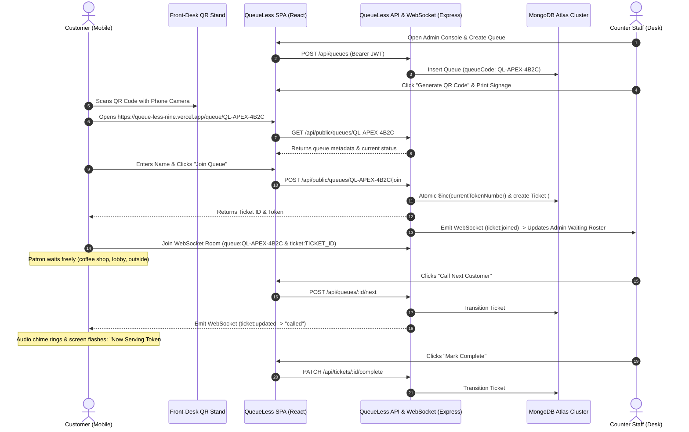
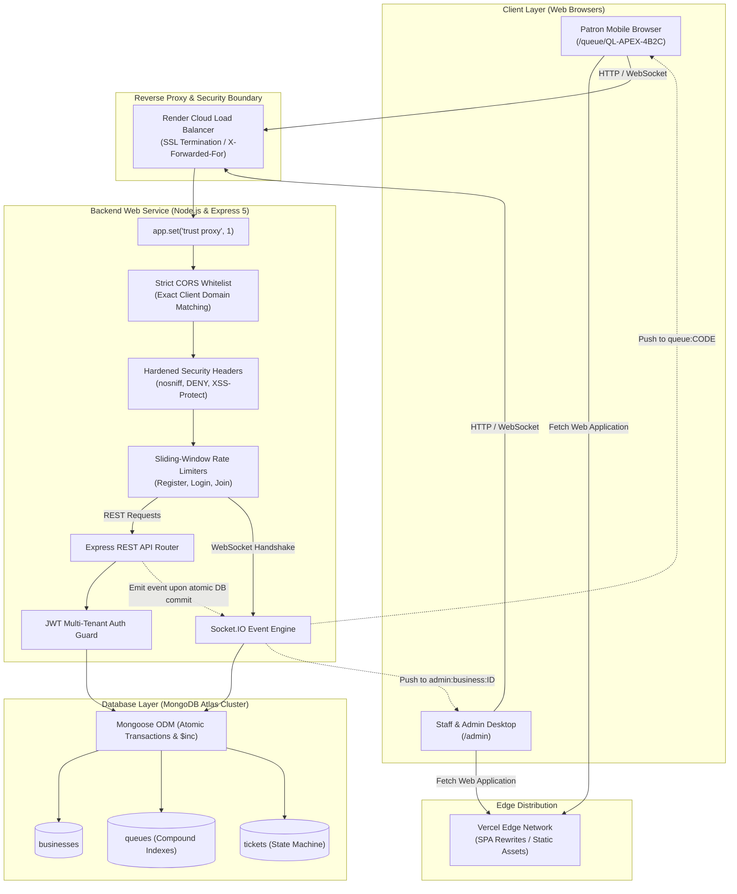

<div align="center">

# ⚡ QueueLess
### Smart Live Queue Management System

**A modern, production-ready virtual queue management platform that eliminates physical lines through contactless QR code check-in, real-time WebSocket place tracking, and a high-throughput admin dispatch console.**

[](https://react.dev/)
[](https://tailwindcss.com/)
[](https://vitejs.dev/)
[](https://nodejs.org/)
[](https://expressjs.com/)
[](https://socket.io/)
[](https://www.mongodb.com/atlas)
[](LICENSE)
[](server/test_phase5_production.js)

<br />

[🌐 **Live Production Demo**](https://queue-less-nine.vercel.app) &nbsp;•&nbsp;
[📂 **GitHub Repository**](https://github.com/vivek28n/QueueLess) &nbsp;•&nbsp;
[⚡ **Quick Start Guide**](#-getting-started) &nbsp;•&nbsp;
[📖 **API Specification**](#-api-documentation) &nbsp;•&nbsp;
[🛡️ **Security Architecture**](#-security--hardening)

<br />

```text
       ┌───────────────────────────────┐
       │   Customer Scans QR Code      │ ──► Mobile Web Portal (No App Needed)
       └──────────────┬────────────────┘
                      ▼
       ┌───────────────────────────────┐
       │ Atomic Token Issued (#104)    │ ──► Live Place-in-Line & Estimated Wait
       └──────────────┬────────────────┘
                      ▼
       ┌───────────────────────────────┐
       │ Real-Time WebSocket Streaming │ ──► Sub-millisecond Push on "Call Next"
       └──────────────┬────────────────┘
                      ▼
       ┌───────────────────────────────┐
       │ Desk Admin Dispatch Console   │ ──► Instant Call / Skip / Complete Action
       └───────────────────────────────┘
```

</div>

---

## 📑 Table of Contents

- [Overview](#-overview)
  - [The Real-World Problem](#the-real-world-problem)
  - [How QueueLess Solves It](#how-queueless-solves-it)
- [Key Features](#-key-features)
- [Application Previews](#-application-previews)
- [How It Works](#-how-it-works)
- [Technology Stack](#-technology-stack)
- [System Architecture](#-system-architecture)
- [Project Structure](#-project-structure)
- [Getting Started](#-getting-started)
  - [Prerequisites](#prerequisites)
  - [Installation](#installation)
  - [Environment Configuration](#environment-configuration)
  - [Running Locally](#running-locally)
- [Environment Variables](#-environment-variables)
- [API Documentation](#-api-documentation)
- [Socket.IO Real-Time Protocol](#-socketio-real-time-protocol)
- [Security & Hardening](#-security--hardening)
- [Automated Testing & Verification](#-automated-testing--verification)
- [Production Deployment](#-production-deployment)
  - [Render (Backend Web Service)](#1-backend-deployment-render)
  - [Vercel (Frontend SPA)](#2-frontend-deployment-vercel)
  - [MongoDB Atlas (Database)](#3-database-setup-mongodb-atlas)
- [Future Roadmap](#-future-roadmap)
- [Contributing](#-contributing)
- [License](#-license)
- [Author](#-author)

---

## 📋 Overview

### The Real-World Problem

Physical waiting lines in clinics, banks, government desks, restaurants, and retail venues are inherently inefficient and frustrating:
- **Congestion & Anxiety**: Crowded waiting lobbies create stress, elevated noise levels, and customer dissatisfaction.
- **Wasted Patron Time**: Customers are chained to a physical perimeter, unable to step away or run errands while waiting.
- **Manual Overhead**: Thermal paper ticket machines jam, run out of paper, and fail to provide customers with dynamic wait time updates.
- **Counter Inefficiency**: Counter staff lack predictive visibility into queue volume, average handling times, and abandon rates.

### How QueueLess Solves It

**QueueLess** transforms physical queues into dynamic, mobile-first virtual waiting rooms. Patrons scan a counter QR code using their standard smartphone camera, immediately receiving an atomic, sequential digital token.

With **sub-millisecond WebSocket streaming**, customers monitor their real-time place in line and calculated wait time from anywhere within range—stepping outside for fresh air, visiting nearby shops, or sitting comfortably until summoned by an audio-visual dispatch alert.

Front-desk teams and administrators manage counter flow through an enterprise-grade desk console featuring instant **"Call Next"**, **"Skip"**, and **"Complete"** workflows backed by an atomic state machine.

---

## ✨ Key Features

| Category | Capability | Technical Highlight |
| :--- | :--- | :--- |
| **Patron Experience** | **Zero-App Contactless Check-In** | Instant onboarding via standard mobile web browser; no app installation or account registration required. |
| **Real-Time Engine** | **Live WebSocket Place Tracking** | Sub-millisecond position updates (`position`, `peopleAhead`, `estimatedWaitTime`) with audio and visual summon alerts. |
| **Desk Operations** | **Admin Dispatch Desk** | Multi-queue command center with single-click **Call Next**, **Skip**, and **Complete** actions and queue pause/resume controls. |
| **Data Integrity** | **Atomic Concurrency Guarantee** | Prevents duplicate token collisions during sudden traffic spikes via MongoDB `$inc` operations and compound unique indexes. |
| **Multi-Tenancy** | **Strict Business Data Isolation** | Complete multi-tenant scoping; administrators only see and control queues, tickets, and metrics belonging to their organization. |
| **Authentication** | **Role-Based Access Control (RBAC)** | JSON Web Token (JWT) authentication securing admin endpoints and private business WebSocket rooms for staff and administrators. |
| **Front-Desk Tools** | **Dynamic QR Code Generator** | Canvas-based high-resolution QR generator with instant PNG export for front-counter signage and stand displays. |
| **Production Ready** | **Enterprise Security Hardening** | Sliding-window IP rate limiting, strict CORS exact whitelisting, RFC 5322 input sanitization, and 72-byte bcrypt protection. |

---

## 📸 Application Previews

> [!NOTE]
> *QueueLess features a dark modern SaaS design built with Tailwind CSS v4 and responsive primitives. Live screenshots can be captured directly from the running deployment.*

```text
┌────────────────────────────────────────────────────────────────────────────────────────┐
│                               Customer Mobile Live View                                │
├────────────────────────────────────────────────────────────────────────────────────────┤
│                                                                                        │
│   [ Apex Health Clinic ]                                      Status: Active ●         │
│   General Consultation Queue                                  Code: QL-APEX-4B2C       │
│                                                                                        │
│   ┌────────────────────────────────────────────────────────────────────────────────┐   │
│   │                                YOUR TOKEN                                      │   │
│   │                                   #14                                          │   │
│   │                          Estimated Wait: ~8 mins                               │   │
│   └────────────────────────────────────────────────────────────────────────────────┘   │
│                                                                                        │
│   ● Now Serving: Token #12         ● Ahead of You: 1 Person                            │
│                                                                                        │
│   [ Live WebSocket Connected ]                                [ Leave Queue ]          │
│                                                                                        │
└────────────────────────────────────────────────────────────────────────────────────────┘
```

### Visual Capture Gallery Guide

| View | Primary Component | Path / Route | Description |
| :--- | :--- | :--- | :--- |
| **Customer Live Queue** | `CustomerQueuePage.jsx` | `/queue/:queueCode` | Real-time animated token card, wait-time calculation, summon chime, and auto-refresh. |
| **Admin Dispatch Console** | `AdminDashboardPage.jsx` | `/admin` | Live ticket roster, counter dispatch buttons, daily throughput stats, and queue switcher. |
| **Counter QR Modal** | `QRCodeModal.jsx` | Admin Modal | High-resolution QR code preview with counter signage layout and one-click PNG export. |
| **Business Portal** | `LoginPage.jsx` / `RegisterPage.jsx` | `/login`, `/register` | Multi-tenant organization onboarding with input validation and JWT issuance. |

---

## 🔄 How It Works



---

## 💻 Technology Stack

<div align="center">

| Domain | Technology | Version | Purpose |
| :--- | :--- | :--- | :--- |
| **Frontend Framework** | [React](https://react.dev/) | `v19.3` | Modern component architecture, hooks, and responsive state |
| **Frontend Tooling** | [Vite](https://vitejs.dev/) | `v8.3` | Sub-second HMR and production roll-up bundling |
| **Routing** | [React Router](https://reactrouter.com/) | `v7.1` | Client-side dynamic routing with SPA rewrites |
| **Styling** | [Tailwind CSS](https://tailwindcss.com/) | `v4.3` | High-performance modern utility-first dark theme |
| **Icons** | [Lucide React](https://lucide.dev/) | `v1.7` | Crisp, scalable user interface icons |
| **QR Code Engine** | [qrcode.react](https://github.com/zpao/qrcode.react) | `v4.2` | Canvas rendering and exportable PNG counter badges |
| **Backend Framework** | [Express](https://expressjs.com/) | `v5.3` | High-throughput REST API with ES Modules |
| **Runtime** | [Node.js](https://nodejs.org/) | `>=18.0` | Server-side JavaScript execution engine |
| **Real-Time Messaging** | [Socket.IO](https://socket.io/) | `v4.8` | Bi-directional WebSocket rooms with polling fallback |
| **Database** | [MongoDB](https://www.mongodb.com/) | `v6 / v7` | High-write document database with WiredTiger engine |
| **ODM Modeling** | [Mongoose](https://mongoosejs.com/) | `v9.1` | Schema validation, compound indexing, and models |
| **Authentication** | [jsonwebtoken](https://github.com/auth0/node-jsonwebtoken) | `v9.0` | Cryptographic Bearer token signing and verification |
| **Password Security** | [bcryptjs](https://github.com/dcodeIO/bcrypt.js) | `v3.0` | Salted password hashing with 72-byte safe handling |
| **Code Quality** | [oxlint](https://oxc.rs/) | `v1.9` | High-speed Rust-based JavaScript and React linter |
| **Hosting (Client)** | [Vercel](https://vercel.com/) | Cloud | Global Edge CDN hosting for single-page applications |
| **Hosting (Server)** | [Render](https://render.com/) | Cloud | Managed containerized Web Service running Node.js |

</div>

---

## 🏛️ System Architecture



---

## 📁 Project Structure

```text
queueless/
├── client/                             # Frontend React 19 + Vite Single-Page Application
│   ├── public/                         # Public static icons (favicon.svg, icons.svg)
│   ├── src/
│   │   ├── components/
│   │   │   ├── auth/
│   │   │   │   └── ProtectedRoute.jsx  # Route guard checking authentication state
│   │   │   ├── layout/
│   │   │   │   ├── Header.jsx          # Responsive dark navbar with user profile
│   │   │   │   └── Footer.jsx          # Application footer and build indicators
│   │   │   ├── queue/
│   │   │   │   └── QRCodeModal.jsx     # High-res QR renderer with PNG export
│   │   │   └── ui/                     # Dark-mode UI primitives (Button, Card, Badge, Input)
│   │   ├── context/
│   │   │   └── AuthContext.jsx         # React Context managing session & Bearer tokens
│   │   ├── pages/
│   │   │   ├── LandingPage.jsx         # SaaS landing page with queue search lookup
│   │   │   ├── LoginPage.jsx           # Staff & administrator sign-in portal
│   │   │   ├── RegisterPage.jsx        # Organization onboarding & admin registration
│   │   │   ├── CustomerQueuePage.jsx   # Mobile-first customer live place-in-line view
│   │   │   ├── AdminDashboardPage.jsx  # Admin dispatch desk with queue management
│   │   │   └── NotFoundPage.jsx        # 404 error page
│   │   ├── services/
│   │   │   ├── api.js                  # Axios client configured with base URL & JWT interceptor
│   │   │   └── socket.js               # Socket.IO connection manager & room hooks
│   │   ├── App.jsx                     # Route definitions & React Router setup
│   │   ├── index.css                   # Tailwind CSS v4 variables & custom glows
│   │   └── main.jsx                    # Application root bootstrap
│   ├── .env.example                    # Client environment template
│   ├── package.json                    # Client dependencies & scripts
│   ├── vercel.json                     # Vercel SPA routing rewrites & security headers
│   └── vite.config.js                  # Vite configuration with Tailwind & dev proxy
│
├── server/                             # Backend Express API & Real-Time Server
│   ├── src/
│   │   ├── config/
│   │   │   └── db.js                   # MongoDB Atlas connection manager & dev engine
│   │   ├── controllers/
│   │   │   ├── authController.js       # Register, login, session lookup, input validation
│   │   │   ├── healthController.js     # Sanitized uptime & diagnostics endpoint
│   │   │   ├── queueController.js      # Authenticated queue CRUD & next dispatch
│   │   │   ├── publicQueueController.js# Public queue inspection, join, & ticket check
│   │   │   └── ticketController.js     # Ticket lifecycle operations (skip, complete)
│   │   ├── middleware/
│   │   │   ├── authMiddleware.js       # Bearer JWT verification & multi-tenant guard
│   │   │   ├── errorHandler.js         # Sanitized error handler (no stack trace leak)
│   │   │   ├── rateLimiter.js          # Sliding-window IP limiters (register, login, join)
│   │   │   └── securityHeaders.js      # Production HTTP headers (nosniff, DENY, XSS)
│   │   ├── models/
│   │   │   ├── Business.js             # Multi-tenant business schema & unique businessId
│   │   │   ├── User.js                 # User accounts with bcrypt hashing & 72-byte check
│   │   │   ├── Queue.js                # Queue schema with atomic counters & unique codes
│   │   │   └── Ticket.js               # Ticket model with lifecycle state machine
│   │   ├── routes/
│   │   │   ├── authRoutes.js           # /api/auth routes
│   │   │   ├── healthRoutes.js         # /api/health route
│   │   │   ├── queueRoutes.js          # /api/queues routes
│   │   │   ├── publicRoutes.js         # /api/public routes
│   │   │   └── ticketRoutes.js         # /api/tickets routes
│   │   ├── services/
│   │   │   └── socketService.js        # Socket.IO room lifecycle & real-time dispatch hub
│   │   ├── utils/
│   │   │   └── token.js                # JWT sign/verify with production secret validation
│   │   └── index.js                    # Express app bootstrap, 0.0.0.0 binding, CORS
│   ├── .env.example                    # Server environment template
│   ├── package.json                    # Server dependencies & test runner scripts
│   ├── test_e2e_auth.js                # Auth & proxy integration tests (20 assertions)
│   ├── test_e2e_queue.js               # Queue CRUD & atomic concurrency tests (78 assertions)
│   ├── test_persistence.js            # Cold-restart database persistence tests
│   ├── test_e2e_realtime.js           # Socket.IO rooms & real-time flow tests (41 assertions)
│   └── test_phase5_production.js       # Production security & regression tests (8 assertions)
│
├── .gitignore                          # Workspace gitignore rules
├── package.json                        # Root workspace scripts (dev:server, dev:client)
└── README.md                           # System documentation
```

---

## 🚀 Getting Started

### Prerequisites

Ensure you have the following installed locally:
- **Node.js**: `v18.0.0` or higher (tested on Node v20 & v24)
- **npm**: `v9.0.0` or higher
- **MongoDB**: A running local MongoDB instance on port `27017` **OR** a free [MongoDB Atlas](https://www.mongodb.com/cloud/atlas) cluster connection URI.

### Installation

1. **Clone the repository**:
   ```bash
   git clone https://github.com/vivek28n/QueueLess.git
   cd QueueLess
   ```

2. **Install server dependencies**:
   ```bash
   cd server
   npm install
   ```

3. **Install client dependencies**:
   ```bash
   cd ../client
   npm install
   ```

### Environment Configuration

1. **Configure the backend environment** (`server/.env`):
   ```bash
   cd ../server
   cp .env.example .env
   ```
   *(Update `.env` with your preferred values or keep the development defaults shown below).*

2. **Configure the frontend environment** (`client/.env.local` — *optional for local dev*):
   ```bash
   cd ../client
   cp .env.example .env.local
   ```

### Running Locally

You can launch the frontend and backend in separate terminal windows:

#### Terminal 1 — Backend API & WebSocket Server:
```bash
cd server
npm run dev
```
*The server will start at `http://localhost:5000`.*

#### Terminal 2 — Frontend React + Vite SPA:
```bash
cd client
npm run dev
```
*The frontend will launch at `http://localhost:5173`.*

Open your browser to `http://localhost:5173` to explore QueueLess.

---

## 🔐 Environment Variables

### Backend Configuration (`server/.env`)

| Variable | Required | Default / Example | Purpose |
| :--- | :---: | :--- | :--- |
| `NODE_ENV` | Optional | `development` | Environment mode (`development`, `production`, `test`). |
| `PORT` | Optional | `5000` | Port for the Express and Socket.IO server. Bound to `0.0.0.0`. |
| `HOST` | Optional | `0.0.0.0` | Network binding host interface. |
| `CLIENT_URL` | **Yes (Prod)**| `http://localhost:5173` | Exact allowed frontend origin for CORS and WebSockets. |
| `ALLOWED_ORIGINS`| Optional | `https://queue-less-nine.vercel.app` | Additional comma-separated allowed origins. |
| `MONGODB_URI` | **Yes (Prod)**| `mongodb://localhost:27017/queueless` | MongoDB connection URI (Atlas string in production). |
| `JWT_SECRET` | **Yes (Prod)**| *(cryptographic 32+ char string)* | Cryptographic secret for signing JWT tokens. |
| `JWT_EXPIRES_IN` | Optional | `7d` | Token expiration timespan (e.g., `7d`, `24h`). |

### Frontend Configuration (`client/.env.local`)

| Variable | Required | Default / Example | Purpose |
| :--- | :---: | :--- | :--- |
| `VITE_API_URL` | Optional | `http://localhost:5000/api` | Backend REST API endpoint. |
| `VITE_SOCKET_URL` | Optional | `http://localhost:5000` | Backend WebSocket root URL for Socket.IO. |
| `VITE_PUBLIC_URL` | Optional | `http://localhost:5173` | Public base URL used when generating customer QR codes. |

---

## 📖 API Documentation

All administrative endpoints require an `Authorization: Bearer <JWT>` header.

### 1. Authentication Endpoints (`/api/auth`)

```text
POST /api/auth/register
Access: Public (Rate limited: 10/hour per IP)
Body:   { businessName, adminName, email, password, industry }
Result: HTTP 201 Created -> { status, token, user }
Note:   Enforces minimum 8 chars, maximum 72 UTF-8 bytes for password.
```

```text
POST /api/auth/login
Access: Public (Rate limited: 20/15min per IP)
Body:   { email, password, role? }
Result: HTTP 200 OK -> { status, token, user }
Note:   Caps input at 1024 bytes to mitigate bcrypt DoS attacks.
```

```text
GET /api/auth/me
Access: Authenticated (Bearer JWT)
Result: HTTP 200 OK -> { status, user: { id, name, email, role, business } }
```

### 2. Admin Queue Management (`/api/queues`)

| Method | Route | Access | Purpose |
| :--- | :--- | :--- | :--- |
| `POST` | `/api/queues` | Admin | Create a new queue (with custom or auto-generated `queueCode`). |
| `GET` | `/api/queues` | Admin | List all queues for the authenticated business with live stats. |
| `GET` | `/api/queues/:id` | Admin | Fetch detailed queue data including the waiting tickets roster. |
| `PATCH` | `/api/queues/:id` | Admin | Update queue metadata or switch status (`active`, `paused`, `closed`). |
| `POST` | `/api/queues/:id/next` | Admin | Call the next waiting patron; auto-completes previous active ticket. |

### 3. Admin Ticket Management (`/api/tickets`)

| Method | Route | Access | Purpose |
| :--- | :--- | :--- | :--- |
| `PATCH` | `/api/tickets/:id/skip` | Admin | Mark an absent patron as `skipped`. |
| `PATCH` | `/api/tickets/:id/complete` | Admin | Mark active ticket as `completed` and close the counter session. |

### 4. Public Customer Endpoints (`/api/public`)

```text
GET /api/public/queues/:queueCode
Access: Public
Result: Returns queue name, business name, status, current serving token, & wait estimate.
```

```text
POST /api/public/queues/:queueCode/join
Access: Public (Rate limited: 30/5min per IP)
Body:   { customerName, customerContact? }
Result: HTTP 201 Created -> Returns issued ticket with unique atomic tokenNumber & position.
```

```text
GET /api/public/tickets/:ticketId
Access: Public
Result: Returns real-time position, peopleAhead, status, & estimatedWaitTimeMinutes.
```

### 5. Health & Diagnostics (`/api/health`)

```text
GET /api/health
Access: Public
Result: Returns uptime, memory usage, environment, and sanitized database readyState.
```

---

## ⚡ Socket.IO Real-Time Protocol

### Room Isolation Architecture

- **Public Queue Room (`queue:<queueCode>`)**: Joined by customers. Receives broadcasts when currently serving token changes or queue pauses.
- **Private Customer Room (`ticket:<ticketId>`)**: Joined by an individual patron. Receives personal summons (`ticket:updated`).
- **Private Business Room (`admin:business:<businessId>`)**: Secured via Bearer JWT verification. Receives administrative updates when patrons join (`ticket:joined`) or state shifts occur.

### Socket Events Reference

```text
Client ──► Server:
  queue:join       { queueCode }           Subscribe to public queue room
  admin:subscribe  { token }               Authenticate & subscribe to business admin room

Server ──► Client:
  queue:state      { queue, stats }        Initial queue snapshot upon joining
  queue:updated    { queue, stats }        Emitted on desk calls, pause/resume, or closures
  ticket:joined    { ticket, stats }       Emitted to admin room when a patron enters the line
  ticket:updated   { ticket, position... } Emitted to patron when called, skipped, or completed
  queue:error      { message }             Emitted upon invalid codes or unauthorized actions
```

---

## 🛡️ Security & Hardening

QueueLess incorporates comprehensive production-grade security safeguards:

- **Bcrypt 72-Byte Boundary Safe Handling**:
  - Registration rejects passwords exceeding 72 UTF-8 bytes using `Buffer.byteLength(password, 'utf8')`, matching bcrypt's internal truncation limit and preventing character-bypass vulnerabilities.
  - Login safely accepts inputs up to 1024 bytes, preventing bcrypt CPU-exhaustion DoS attacks while preserving 100% backward compatibility for legacy accounts.
- **Strict Production JWT Safeguard**:
  - The server validates `process.env.JWT_SECRET` immediately on startup.
  - In production mode (`NODE_ENV=production`), startup fails with a fatal error if the secret is missing, shorter than 32 characters, or matches development placeholders.
- **Exact CORS Origin Whitelisting**:
  - In production, wildcard allowances and `*.vercel.app` suffix matches are eliminated. Only exact origins configured in `CLIENT_URL` or `ALLOWED_ORIGINS` are permitted.
  - Express HTTP routes and Socket.IO handshakes share the identical CORS policy.
  - Localhost origins (`localhost:5173`, `127.0.0.1:5173`) are allowed only when `NODE_ENV !== 'production'`.
- **Sliding-Window IP Rate Limiting**:
  - `registerLimiter`: Max 10 account creations per hour per IP.
  - `loginLimiter`: Max 20 login attempts per 15 minutes per IP (brute-force defense).
  - `publicJoinLimiter`: Max 30 queue join requests per 5 minutes per IP (token-flood defense).
  - Configured with `app.set('trust proxy', 1)` to accurately resolve client IPs behind Render cloud load balancers.
- **Hardened HTTP Headers**:
  - `X-Content-Type-Options: nosniff`
  - `X-Frame-Options: DENY`
  - `X-XSS-Protection: 1; mode=block`
  - `Referrer-Policy: strict-origin-when-cross-origin`
  - `X-Powered-By` header completely stripped.
- **Database Safety Guard**:
  - In production mode, local `.data` fallback is strictly prohibited; the server requires an authenticated MongoDB Atlas connection string.
  - Database URI sanitization strips accidentally copied quotation marks and warns on unencoded special characters without logging credentials.

---

## 🧪 Automated Testing & Verification

QueueLess contains an end-to-end automated test suite verifying all system components.

### Execute All Backend Tests:
```bash
cd server
npm test
```

### Verified Test Suite Breakdown (147 Total Passing Assertions):

```text
======================================================================
1. Authentication & Security Suite (test_e2e_auth.js)
   ✔ 20/20 PASSED: Registration, bcrypt hashing, JWT token verification,
     NoSQL injection prevention, password length bounds, /api/auth/me.

2. Core Queue & Concurrency Suite (test_e2e_queue.js)
   ✔ 78/78 PASSED: Queue CRUD, status transitions, position calculations,
     cross-tenant data isolation, and atomic concurrency testing
     with 10 simultaneous customer join requests without token collisions.

3. Cold-Restart Data Persistence (test_persistence.js)
   ✔ PASSED: Cold restart verification against persistent storage engine.

4. Socket.IO Real-Time & QR Suite (test_e2e_realtime.js)
   ✔ 41/41 PASSED: Room isolation, admin JWT subscription, zero customer
     contact leaks in public broadcasts, live dispatch summons, and reconnection.

5. Production Hardening & Regression Suite (test_phase5_production.js)
   ✔ 8/8 PASSED: Security headers, safe health reporting, exact CORS policy,
     production JWT guard, bcrypt 72-byte multibyte checks, legacy account
     login compatibility, sliding-window rate limiters, and DB guard.
======================================================================
TOTAL: 147 PASSED | 0 FAILED (Exit Code 0)
```

### Code Quality & Build Verification:
```bash
# Frontend linting (0 errors)
cd client
npm run lint

# Production build verification (Vite bundle)
cd client
npm run build
```

---

## 🌐 Production Deployment

QueueLess is designed to deploy seamlessly to cloud PaaS platforms.

### 1. Backend Deployment: Render

Deploy `server` as a **Web Service** on [Render](https://render.com):

| Setting | Value |
| :--- | :--- |
| **Service Type** | Web Service |
| **Root Directory** | `server` |
| **Environment** | `Node` |
| **Build Command** | `npm install` |
| **Start Command** | `node src/index.js` |
| **Health Check Path** | `/api/health` |

#### Required Render Environment Variables:
```env
NODE_ENV=production
PORT=10000
CLIENT_URL=https://queue-less-nine.vercel.app
JWT_SECRET=your_strong_cryptographic_secret_min_32_characters
JWT_EXPIRES_IN=7d
MONGODB_URI=mongodb+srv://<user>:<password>@cluster0.mongodb.net/queueless?retryWrites=true&w=majority
```

### 2. Frontend Deployment: Vercel

Deploy `client` as a **Static Site** on [Vercel](https://vercel.com):

| Setting | Value |
| :--- | :--- |
| **Framework Preset** | `Vite` |
| **Root Directory** | `client` |
| **Build Command** | `npm run build` |
| **Output Directory** | `dist` |
| **Install Command** | `npm install` |

#### Required Vercel Environment Variables:
```env
VITE_API_URL=https://<your-render-service>.onrender.com/api
VITE_SOCKET_URL=https://<your-render-service>.onrender.com
VITE_PUBLIC_URL=https://queue-less-nine.vercel.app
```

The repository includes [`client/vercel.json`](file:///c:/Users/Vivek%20Nigam/.gemini/antigravity/scratch/queueless/client/vercel.json) with SPA rewrites to ensure direct URL navigation and page refreshes on dynamic routes never return 404 errors.

### 3. Database Setup: MongoDB Atlas

1. Create a free or dedicated cluster on [MongoDB Atlas](https://www.mongodb.com/cloud/atlas).
2. Under **Database Access**, create a user with `readWrite` privileges on the `queueless` database.
3. Under **Network Access**, allow access from `0.0.0.0/0` (required for dynamic cloud egress IPs).
4. If your password contains special characters (`@`, `:`, `#`, `%`), URL-encode them per RFC 3986 (e.g., `@` becomes `%40`).

---

## 🗺️ Future Roadmap

- [ ] **SMS & WhatsApp Summon Dispatch**: Optional customer SMS or WhatsApp notifications via Twilio / Meta Graph API when 2 patrons remain ahead.
- [ ] **Lounge TV / Big-Screen Kiosk View**: A dedicated high-contrast, fullscreen `/display/:queueCode` monitor view for waiting room television screens.
- [ ] **Distributed Rate Limiting with Redis**: External Redis backing for rate limiters to support horizontal multi-instance container autoscaling.
- [ ] **Analytics & Velocity Dashboard**: Historical reporting on average counter service durations, peak hours, and customer wait trends.
- [ ] **Multi-Language Customer Localization**: Support for English, Spanish, French, and Hindi in the public customer queue view.

---

## 🤝 Contributing

Contributions to QueueLess are welcome! Please follow these steps:

1. **Fork the Repository**: Click the `Fork` button at the top right of this page.
2. **Create a Feature Branch**:
   ```bash
   git checkout -b feature/amazing-feature
   ```
3. **Commit Your Changes**:
   ```bash
   git commit -m "feat: add amazing feature"
   ```
4. **Verify Tests**:
   ```bash
   cd server && npm test
   cd ../client && npm run lint && npm run build
   ```
5. **Push to Your Branch**:
   ```bash
   git push origin feature/amazing-feature
   ```
6. **Open a Pull Request**: Submit your PR with a descriptive summary of your changes.

---

## 📄 License

This project is licensed under the **ISC License**. See the [package.json](package.json) file for details.

---

## 👨‍💻 Author

**Vivek Nigam**
GitHub: [@vivek28n](https://github.com/vivek28n)
Project Repository: [https://github.com/vivek28n/QueueLess](https://github.com/vivek28n/QueueLess)

<div align="center">
  <sub>Built with precision for seamless queue management. If QueueLess helped your business, give it a ⭐️ on GitHub!</sub>
</div>
