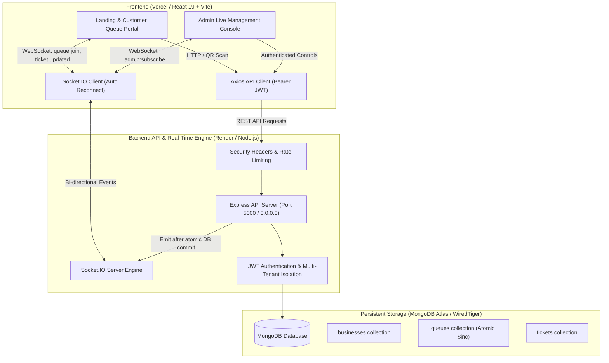

# QueueLess — Smart Live Queue Management System

A production-ready, full-stack live queue management system built with Node.js, Express, Socket.IO, MongoDB, React 19, and Tailwind CSS. Customers can join virtual queues via contactless QR code check-in and track their live place-in-line with sub-millisecond WebSocket updates, while venue administrators manage service counters and dispatches in real time.

---

## 📌 Architecture Overview



---

## 🚀 Key Features

### 1. Contactless QR Code Customer Check-In
- Instant virtual waiting room entry by scanning a counter QR code or opening a short link.
- **Zero App Friction**: Runs directly in any mobile web browser without requiring customer app installations or account creation.
- Dynamic high-resolution QR code generator with branded printable export (PNG) for front-desk counters.
- Generates clean public URLs using unique public `queueCode` identifiers (never exposing internal database IDs).

### 2. Live WebSocket Queue Tracking
- Powered by Socket.IO with bi-directional streaming and fallback transports (`websocket`, `polling`).
- Real-time updates for:
  - Live place in line (`position` and `peopleAhead`).
  - Rolling estimated wait times based on average service speeds.
  - Desk dispatch summons (`"Now Serving Token #X"`).
  - Audio chimes and visual screen alerts when summoned.
- Automatic reconnection with authoritative database state synchronization to prevent stale in-memory state.

### 3. High-Throughput Admin Control Console
- Multi-queue operational dashboard for front-desk staff and administrators.
- Instant actions: **"Call Next"**, **"Skip"**, and **"Complete"** with strict state machine validation.
- Live queue metrics: Waiting patrons, active counter session, completed count, and daily throughput.
- Queue status switching (`active`, `paused`, `closed`) with immediate real-time broadcast to all waiting customers.

### 4. Concurrency-Safe Atomic Token Issuance
- Eliminates duplicate token collisions under heavy traffic spikes using atomic MongoDB `$inc` operations combined with compound unique indexes (`{ queue: 1, tokenNumber: 1 }`).
- Guaranteed strictly sequential token numbering per queue.

### 5. Multi-Tenant Business Isolation & Role-Based Access Control
- Every queue and ticket is strictly scoped to a verified `Business` entity.
- Role-based JWT authentication (`admin` and `staff`).
- Cross-tenant requests are strictly blocked at both HTTP and WebSocket boundaries.

### 6. Production Security & Reliability Hardening
- **Sliding-Window Rate Limiting**: Built-in protections on `/api/auth/register` (max 10/hr), `/api/auth/login` (brute-force defense, max 20/15min), and `/api/public/queues/:queueCode/join` (anti-spam token throttling, max 30/5min) with proxy IP resolution.
- **Strict Production JWT Guard**: Hardcoded secret fallback eliminated in production; requires cryptographically strong `JWT_SECRET` (>= 32 chars) on startup.
- **Exact CORS Whitelist**: Blanket `*.vercel.app` wildcards eliminated; only exact `CLIENT_URL` and explicitly configured `ALLOWED_ORIGINS` are permitted across HTTP and WebSockets.
- **Input Sanitization & Password Policies**: Enforces minimum 8-character password policy, safe string type-checking to prevent NoSQL injection, and length bounds on all user inputs.
- **Hardened HTTP Headers**: Strict `X-Content-Type-Options: nosniff`, `X-Frame-Options: DENY`, `X-XSS-Protection: 1; mode=block`, `Referrer-Policy: strict-origin-when-cross-origin`, HSTS, and removal of `X-Powered-By`.
- **Database Safety Guard**: Strict production mode forbids local `.data` fallback and requires MongoDB Atlas connection; unhandled server errors sanitize stack traces from client responses.

---

## 🛠️ Technology Stack

| Layer | Technologies |
| :--- | :--- |
| **Frontend Framework** | React 19, Vite 8, React Router DOM 7 |
| **Styling & UI** | Tailwind CSS v4, Lucide React Icons |
| **Backend Framework** | Node.js (v18+), Express 5 (ES Modules) |
| **Real-Time Engine** | Socket.IO 4 (WebSockets with polling fallback) |
| **Database** | MongoDB 6+ / 7+, Mongoose 9 (Atlas / Persistent WiredTiger) |
| **Security & Auth** | JSON Web Tokens (`jsonwebtoken`), `bcryptjs`, Rate Limiting |
| **QR Code Engine** | `qrcode.react` (Canvas render with branded canvas export) |
| **Linting & Testing** | `oxlint`, Native Node.js test runner with assertion suite |

---

## 📁 Repository Structure

```text
queueless/
├── client/                     # Frontend React + Vite SPA
│   ├── public/                 # Static assets & icons
│   ├── src/
│   │   ├── components/
│   │   │   ├── auth/           # Route guards (ProtectedRoute)
│   │   │   ├── layout/         # Header/Navbar, Footer
│   │   │   ├── queue/          # QRCodeModal with export engine
│   │   │   └── ui/             # UI primitives (Button, Card, Badge, Input)
│   │   ├── context/
│   │   │   └── AuthContext.jsx # Global auth session & JWT handling
│   │   ├── pages/
│   │   │   ├── LandingPage.jsx       # Dark SaaS value proposition & search
│   │   │   ├── LoginPage.jsx         # Staff & admin sign-in portal
│   │   │   ├── RegisterPage.jsx      # Organization & admin registration
│   │   │   ├── CustomerQueuePage.jsx # Mobile-first customer live ticket view
│   │   │   ├── AdminDashboardPage.jsx# Admin desk & real-time dispatch desk
│   │   │   └── NotFoundPage.jsx      # 404 error page
│   │   ├── services/
│   │   │   ├── api.js          # Axios client with base URL & token interceptor
│   │   │   └── socket.js       # Socket.IO connection manager & rooms
│   │   ├── App.jsx             # React Router routing table
│   │   ├── index.css           # Tailwind CSS v4 theme variables
│   │   └── main.jsx            # React root mount
│   ├── .env.example            # Client environment variable template
│   ├── package.json            # Client dependencies & scripts
│   ├── vercel.json             # Vercel SPA routing rewrites & security headers
│   └── vite.config.js          # Vite config with dev proxy & Tailwind plugin
│
├── server/                     # Backend Express API & Real-Time Server
│   ├── src/
│   │   ├── config/
│   │   │   └── db.js           # Production MongoDB Atlas connection & dev engine
│   │   ├── controllers/
│   │   │   ├── authController.js        # Registration, login, session handlers
│   │   │   ├── healthController.js      # Diagnostics & safe persistence health
│   │   │   ├── queueController.js       # Admin queue management & dispatch
│   │   │   ├── publicQueueController.js # Guest queue query, join & ticket check
│   │   │   └── ticketController.js      # Ticket status updates (skip, complete)
│   │   ├── middleware/
│   │   │   ├── authMiddleware.js        # JWT validation & multi-tenant security
│   │   │   ├── errorHandler.js          # 404 handler & sanitized error middleware
│   │   │   ├── rateLimiter.js           # Sliding-window brute force & join throttler
│   │   │   └── securityHeaders.js       # Standard production security headers
│   │   ├── models/
│   │   │   ├── Business.js              # Multi-tenant business schema
│   │   │   ├── User.js                  # User accounts with bcrypt hashing
│   │   │   ├── Queue.js                 # Queue schema with atomic counters
│   │   │   └── Ticket.js                # Ticket lifecycle & state machine
│   │   ├── routes/
│   │   │   ├── authRoutes.js            # POST /register, POST /login, GET /me
│   │   │   ├── healthRoutes.js          # GET /api/health
│   │   │   ├── queueRoutes.js           # Authenticated /api/queues routes
│   │   │   ├── publicRoutes.js          # Public /api/public routes
│   │   │   └── ticketRoutes.js          # Authenticated /api/tickets routes
│   │   ├── services/
│   │   │   └── socketService.js         # Socket.IO room lifecycle & event hub
│   │   ├── utils/
│   │   │   └── token.js                 # JWT sign and verification utilities
│   │   └── index.js                     # Express setup, 0.0.0.0 binding, CORS
│   ├── .env.example            # Backend environment variable template
│   ├── package.json            # Server dependencies & test commands
│   ├── test_e2e_auth.js        # Phase 2 Auth & Proxy verification suite
│   ├── test_e2e_queue.js       # Phase 3 Queue Management & Concurrency suite
│   ├── test_persistence.js     # Persistent storage verification across restarts
│   ├── test_e2e_realtime.js    # Phase 4 Socket.IO Real-Time & QR Code suite
│   └── test_phase5_production.js# Phase 5 Security, Headers & Production suite
│
├── .gitignore                  # Global ignore rules (secrets, builds, node_modules)
├── package.json                # Workspace orchestrator
└── README.md                   # System documentation & deployment manual
```

---

## 🌐 Complete API Specification

### Authentication APIs (`/api/auth`)

| Method | Endpoint | Access | Description |
| :--- | :--- | :--- | :--- |
| `POST` | `/api/auth/register` | Public | Register new business organization and primary administrator account. |
| `POST` | `/api/auth/login` | Public (Rate Limited) | Authenticate user with email and password; returns JWT token. |
| `GET` | `/api/auth/me` | Authenticated | Retrieve authenticated user profile and business metadata. |

### Admin Queue Management APIs (`/api/queues`)

| Method | Endpoint | Access | Description |
| :--- | :--- | :--- | :--- |
| `POST` | `/api/queues` | Authenticated Admin | Create a new queue with optional custom queue code. |
| `GET` | `/api/queues` | Authenticated Admin | List all queues belonging to the authenticated business with live stats. |
| `GET` | `/api/queues/:id` | Authenticated Admin | Get queue details, waiting ticket roster, and performance metrics. |
| `PATCH` | `/api/queues/:id` | Authenticated Admin | Update queue metadata, status (`active`, `paused`, `closed`), or avg service time. |
| `POST` | `/api/queues/:id/next` | Authenticated Admin | Call next waiting customer; automatically completes previous active ticket. |

### Admin Ticket Management APIs (`/api/tickets`)

| Method | Endpoint | Access | Description |
| :--- | :--- | :--- | :--- |
| `PATCH` | `/api/tickets/:id/skip` | Authenticated Admin | Skip a customer ticket with valid state transition verification. |
| `PATCH` | `/api/tickets/:id/complete` | Authenticated Admin | Mark ticket complete and conclude counter session. |

### Public Customer APIs (`/api/public`)

| Method | Endpoint | Access | Description |
| :--- | :--- | :--- | :--- |
| `GET` | `/api/public/queues/:queueCode` | Public | Retrieve public queue status, current serving token, and estimated wait. |
| `POST` | `/api/public/queues/:queueCode/join` | Public (Rate Limited) | Join active queue; atomically generates sequential token and returns ticket. |
| `GET` | `/api/public/tickets/:ticketId` | Public | Real-time position lookup (`position`, `peopleAhead`, `estimatedWaitTimeMinutes`). |

### System Health & Diagnostics (`/api/health`)

| Method | Endpoint | Access | Description |
| :--- | :--- | :--- | :--- |
| `GET` | `/api/health` | Public | Returns service uptime, memory usage, environment, and sanitized DB status. |

---

## ⚡ Socket.IO Real-Time Protocol

### Connection & Room Architecture

- **Public Room**: `queue:<queueCode>` — Joined by customers. Receives queue updates (`queue:updated`).
- **Private Customer Room**: `ticket:<ticketId>` — Joined by individual customers. Receives personal summon updates (`ticket:updated`).
- **Private Business Room**: `admin:business:<businessId>` — Joined only by verified administrators using Bearer JWT. Receives `ticket:joined`, `ticket:updated`, and `queue:updated`.

### Events Reference

```text
Client -> Server:
  queue:join       { queueCode }           -> Subscribe to public queue room
  admin:subscribe  { token }               -> Subscribe to authenticated business room

Server -> Client:
  queue:state      { queue, stats }        -> Initial state upon joining room
  queue:updated    { queue, stats }        -> Emitted on counter calls, pause/resume, status shifts
  ticket:joined    { ticket, stats }       -> Emitted to admin room when patron joins line
  ticket:updated   { ticket, position, ...}-> Emitted to patron when called, skipped, or completed
  queue:error      { message }             -> Emitted on malformed codes or unauthorized actions
```

---

## 🚀 Production Deployment Manual

### 1. Database Setup: MongoDB Atlas

1. Sign in to [MongoDB Atlas](https://www.mongodb.com/cloud/atlas) and create a free or dedicated cluster (M0/M10+).
2. Under **Database Access**, create a database user (e.g., `queueless_admin`) with read/write privileges.
3. Under **Network Access**, add an IP access rule:
   - For cloud platforms (Render/Vercel dynamic egress IPs), allow access from anywhere: `0.0.0.0/0`.
4. Under **Clusters > Connect > Drivers**, copy the connection string:
   ```text
   mongodb+srv://queueless_admin:<PASSWORD>@cluster0.mongodb.net/queueless?retryWrites=true&w=majority
   ```

---

### 2. Backend Deployment: Render (Web Service)

Deploy the Express + Socket.IO server as a **Web Service** on [Render](https://render.com).

#### Exact Render Configuration Settings:

| Configuration Setting | Value |
| :--- | :--- |
| **Service Type** | Web Service |
| **Name** | `queueless-api` (or preferred name) |
| **Environment** | `Node` |
| **Region** | Select closest region to your users |
| **Branch** | `main` |
| **Root Directory** | `server` |
| **Build Command** | `npm install` |
| **Start Command** | `node src/index.js` (or `npm start`) |
| **Health Check Path** | `/api/health` |
| **Auto-Deploy** | Yes |

#### Required Render Environment Variables:

| Variable Name | Example Value | Description |
| :--- | :--- | :--- |
| `NODE_ENV` | `production` | Enables strict production error handling, security headers, and disables dev DB fallback. |
| `PORT` | `10000` | Render sets this automatically; Express listens on `process.env.PORT` bound to `0.0.0.0`. |
| `MONGODB_URI` | `mongodb+srv://...` | Full MongoDB Atlas connection string with database name. |
| `JWT_SECRET` | `a_very_strong_random_secret_at_least_32_chars` | Secret key for signing and verifying JWT tokens. |
| `JWT_EXPIRES_IN` | `7d` | Token expiration lifespan. |
| `CLIENT_URL` | `https://queue-less-nine.vercel.app` | Allowed frontend origin for CORS and Socket.IO (comma-separated for multiple origins). |

---

### 3. Frontend Deployment: Vercel

Deploy the React + Vite frontend on [Vercel](https://vercel.com).

#### Exact Vercel Configuration Settings:

| Configuration Setting | Value |
| :--- | :--- |
| **Framework Preset** | `Vite` |
| **Root Directory** | `client` |
| **Build Command** | `npm run build` |
| **Output Directory** | `dist` |
| **Install Command** | `npm install` |

#### Required Vercel Environment Variables:

| Variable Name | Example Value | Description |
| :--- | :--- | :--- |
| `VITE_API_URL` | `https://queueless-api.onrender.com/api` | Deployed Render backend API URL (with or without trailing `/api`). |
| `VITE_SOCKET_URL` | `https://queueless-api.onrender.com` | Deployed Render backend root URL for Socket.IO WebSockets. |
| `VITE_PUBLIC_URL` | `https://queue-less-nine.vercel.app` | Production frontend domain for QR code URL generation. |

#### SPA Rewrite Guarantee (`client/vercel.json`):
The repository contains `client/vercel.json` configured with SPA rewrites so that direct browser navigation and page refreshes on dynamic routes (e.g., `/queue/QL-APEX-4B2C` or `/admin`) never return 404:
```json
{
  "rewrites": [
    {
      "source": "/(.*)",
      "destination": "/index.html"
    }
  ]
}
```

---

## 💻 Local Development Setup

### 1. Clone Repository & Install Dependencies

```bash
git clone https://github.com/your-username/queueless.git
cd queueless

# Install server dependencies
cd server
npm install

# Install client dependencies
cd ../client
npm install
```

### 2. Configure Environment Files

Create `server/.env`:
```env
PORT=5000
HOST=0.0.0.0
NODE_ENV=development
CLIENT_URL=http://localhost:5173
MONGODB_URI=mongodb://localhost:27017/queueless
JWT_SECRET=dev_jwt_secret_key_change_in_production
JWT_EXPIRES_IN=7d
```

Create `client/.env.local` (optional, defaults to local proxy):
```env
VITE_API_URL=http://localhost:5000/api
VITE_SOCKET_URL=http://localhost:5000
VITE_PUBLIC_URL=http://localhost:5173
```

### 3. Launch Development Servers

#### Terminal 1 — Backend API:
```bash
cd server
npm run dev
```

#### Terminal 2 — Frontend Client:
```bash
cd client
npm run dev
```

Visit the application at `http://localhost:5173`.

---

## 🧪 Automated Testing & Verification Suite

The repository includes comprehensive automated test suites covering authentication, queue concurrency, data persistence, WebSockets, and production readiness.

To run the complete automated test suite:

```bash
cd server
npm test
```

### Test Suite Summary (147 Passing Assertions):

1. **Phase 2 Authentication (`test_e2e_auth.js`)**:
   - 20 assertions validating business creation, bcrypt password hashing, JWT generation, login verification, token tamper resistance, `/api/auth/me` resolution, and Vite proxy forwarding.
2. **Phase 3 Core Queue Management (`test_e2e_queue.js`)**:
   - 78 assertions validating queue creation, status transitions, atomic concurrency safety with simultaneous customer joins, position calculation, and cross-business isolation.
3. **Data Persistence (`test_persistence.js`)**:
   - Verifies with explicit pre-restart and post-restart assertions that records remain fully intact in persistent storage across cold restarts.
4. **Phase 4 Real-Time & QR Code (`test_e2e_realtime.js`)**:
   - 41 assertions validating Socket.IO room isolation, JWT admin room authentication, public privacy shields (zero customer contact exposure), live dispatch summons, reconnection state re-synchronization, and QR code URL format.
5. **Phase 5 Production Security & Regression (`test_phase5_production.js`)**:
   - 8 assertions validating production security headers, safe health status, exact CORS origin enforcement (blocking unwhitelisted *.vercel.app), production JWT secret validation & strength checks, registration password minimum length (8+ chars) & input type safety, registration rate limiting, production DB mode guard (via subprocess), and root metadata.

### Code Quality & Production Build:

```bash
# Frontend code linting (0 errors)
cd client
npm run lint

# Production build verification
cd client
npm run build
```

---

## 📄 License

ISC License. Built with precision for modern queue management.
